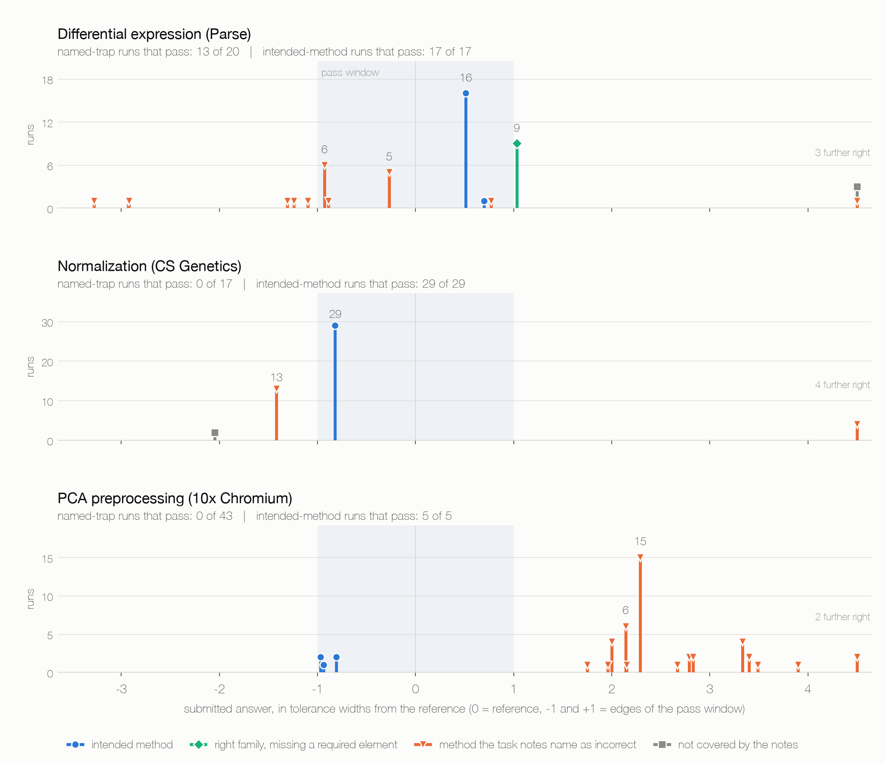
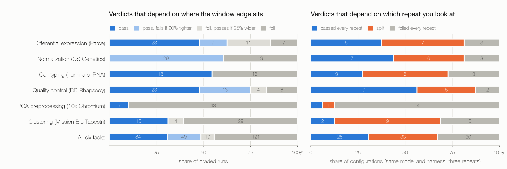
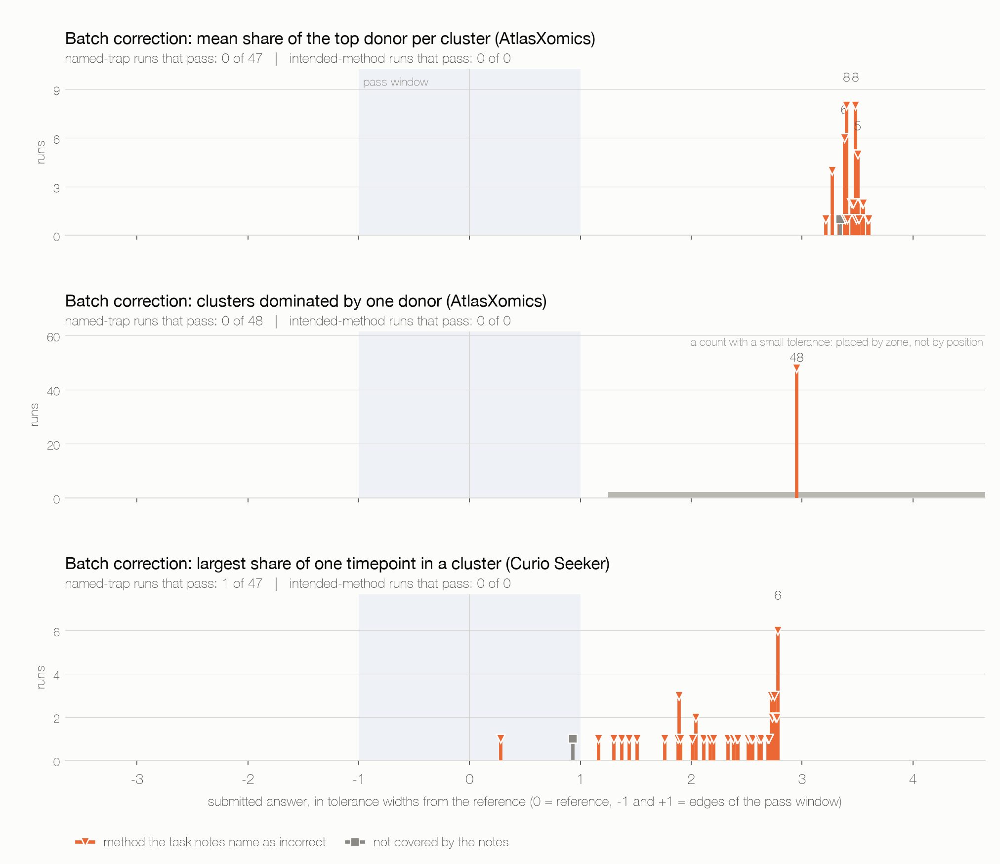
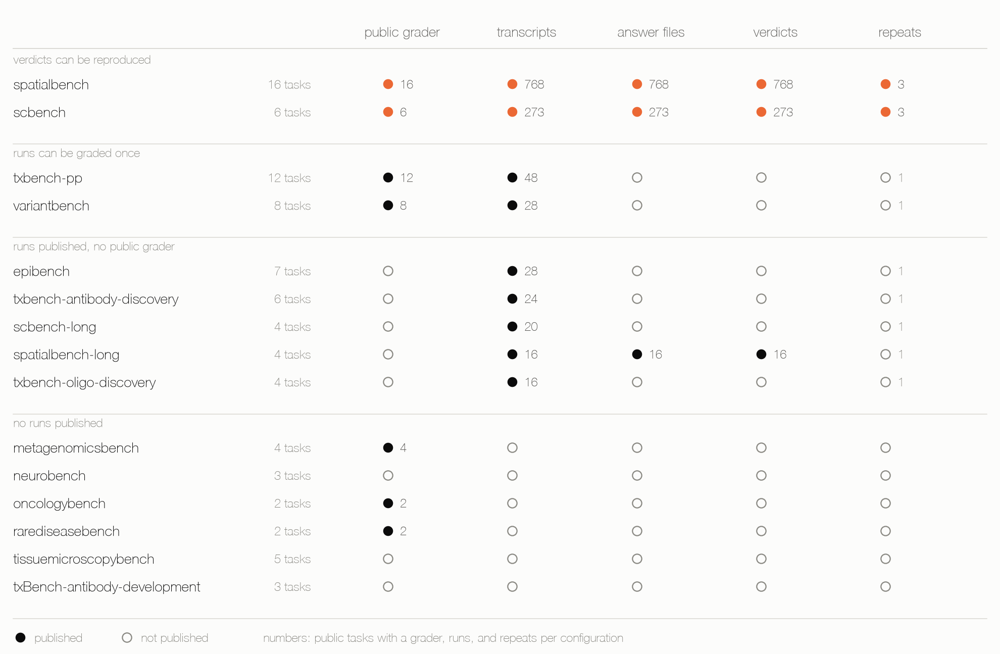

# sc-zprime

**Z-prime for single-cell agent evals.** Assay validation for the benchmarks
that grade AI agents on biology.

In assay development nobody trusts a readout until its controls have been
shown to separate. Z-prime is the standard number for that (Zhang, Chung and
Oldenburg, 1999): it compares the distance between the positive and negative
controls with how much each one scatters. At 0.5 or above an assay is
conventionally good enough to call hits. Below zero the scatter bands of the
two controls overlap and the readout cannot be trusted, however carefully the
plate was run.

Agent benchmarks are assays. The model is the sample, the task is the assay,
and pass or fail is the readout. This repository validates them that way. It
takes the graded runs a benchmark publishes and asks what an assay developer
would ask before believing a result:

- Can an independent implementation reproduce the published verdicts?
- Do the controls separate? Does a run that used the intended analysis pass,
  and does a run that took a named shortcut fail?
- Does the pass window sit on a cliff? How many verdicts flip if a tolerance
  moves a little?
- Do repeats agree? Same model, same task, three runs: same verdict?
- Are there dead readouts, graded fields that nearly every run passes?

New here? Start with the plain-language guide: [docs/EXPLAINER.md](docs/EXPLAINER.md).

The first target is [scBench](https://github.com/latchbio/scbench), LatchBio's
benchmark for single-cell RNA-seq analysis. Its authors published graded runs,
full transcripts and their own design notes for a sample of tasks, which is
what makes validation from the outside possible. Everything in this
repository is computed from that public material: no model was run and no
dataset was downloaded here. A separate repository,
[sc-controls](https://github.com/di-omics/sc-controls), uses the data of 1
scBench task.

## What the public scBench sample shows

Six example tasks, 16 model and harness configurations, 91 task and
configuration pairs with three repeats each: 273 graded runs. Upstream commit
`106726f`, November 2026.

| Question | Result |
|---|---|
| Are the published verdicts reproducible? | Yes. An independent grader agrees on 273 of 273 runs. |
| Does the intended method pass? | Yes, on all three tasks traced: 51 of 51 runs. On one of the three that is 5 runs from a single model. |
| Does a method the task notes call incorrect fail? | On two tasks, always (60 of 60 runs). On differential expression, only 7 of 20 runs (35%, interval 19% to 53%). |
| Do verdicts sit near an edge? | 68 of 273 verdicts (25%) flip if tolerances are 20% tighter or 25% wider. 29 of them are one recipe that the task notes place there on purpose. |
| Do verdicts repeat? | In 33 of 91 pairs (36%) the three repeats did not agree. |
| Are there dead readouts? | 4 of 13 graded fields are passed by at least 95% of runs. |
| How well does the leaderboard resolve? | On the published 195-task table, 10 of the 17 other configurations cannot be told apart from the leader by an unpaired test of the difference. |

Intervals are 95% cluster-bootstrap intervals that resample whole
configurations, because three repeats of one model are not three independent
observations. With 16 configurations they are approximate and probably too
narrow.



Each spike is a group of runs whose answers agree to within 0.01 tolerance
widths. The x axis is distance from the reference answer in tolerance widths,
so the shaded band is the pass window for every task. Colour and marker shape
say which method produced the answer, traced from the code in each run's
transcript and confirmed by blind AI raters.

- **Normalization** and **PCA preprocessing** separate cleanly among the
  answers that were submitted: every intended-method run passes and every
  run that used a method the task notes call incorrect fails.
- **Differential expression** does not. The notes' primary trap is per-cell
  testing with scanpy's default tools, and they expect both of its forms to
  fail: the t-test above the window and the rank test below it. The one
  t-test run fails as expected. The rank test, which is the per-cell method
  agents actually reached for, lands inside the pass window in 13 of 19 runs,
  from seven configurations across all four providers. Six of those thirteen
  sit inside the range the notes accept for correct methods, so no choice of
  window edges that admits the accepted variants can reject them.

Each of these has caveats that matter, and several were anticipated by the
task authors in their own notes. The full account, with every number, its
interval and its limits, is in [docs/FINDINGS.md](docs/FINDINGS.md).



Per-task reports: [results/scbench/validation_cards](results/scbench/validation_cards).

## A second benchmark: SpatialBench

[SpatialBench](https://github.com/latchbio/spatialbench) publishes graded
runs for 16 example tasks in the same form. The tool reads them with one
change to the loader. Upstream commit `baa9841`, November 2026.

| Question | Result |
|---|---|
| Are the published verdicts reproducible? | Yes. An independent grader agrees on 768 of 768 runs. |
| Do verdicts sit near an edge? | 25 of 768 verdicts (3%) flip if every tolerance is made 20% tighter or 25% wider. |
| Do verdicts repeat? | In 46 of 256 pairs (18%) the 3 repeats did not get the same verdict. |
| Does the intended method pass? | Not measurable on the 3 tasks traced: 0 of 144 runs submitted an answer from it. |
| Does a method the task notes call incorrect fail? | Almost always: 141 of 142 runs fail. The 1 pass is on the ovary task and is not a correction. |

3 of the 16 tasks test one decision: whether the agent corrects for the
sample a barcode came from before it clusters. Their prompts ask for a
clustering and a number that measures how far the clusters follow sample
identity. None asks for a correction.



The middle panel is a count with a small tolerance, so its answers are drawn
by zone and not by position (see the data policy).

- **No run submitted a corrected answer.** 142 of 144 runs clustered with no
  sample handling and 2 chose variable genes per sample and corrected nothing
  else. The task notes expect it: all 3 list no correction as their first
  trap.
- **The published runs hold a negative control and no positive one.** They
  show that an uncorrected pipeline fails (142 of 144 runs). The task notes
  list passing values for a corrected pipeline from the authors' own
  analysis, but no published agent run submitted a corrected answer, so the
  runs cannot show a corrected pipeline passing in the agent environment.
- **Many runs name the batch effect.** On the 2 tasks built on the same
  8-donor data, the last stored message of 35 of 96 runs names one: 22 on a
  task whose prompt explains how to read the number, and 13 on a task whose
  prompt does not mention batch effects. That is a keyword count, and the
  page gives its limits. Separately, 2 runs ran a correction method and then
  submitted the uncorrected number.

The full account, including what the transcripts show about the reference
method in the agent environment, is in [docs/SPATIALBENCH.md](docs/SPATIALBENCH.md).
The method labels on these 3 tasks were set by rule and reviewed by AI
models. They have not been through the blind re-rating described below, and
no person has checked them.

## The rest of the family

LatchBio publishes more benchmarks than these 2, and each publishes a
different part of what a validation needs. `sc-zprime inventory` counts it
for 15 of their repositories (86 public tasks, 1221 transcripts):

- 2 publish per-run verdicts and repeats, so verdicts can be reproduced and
  measured: scBench and SpatialBench, above.
- 2 more publish grader configs and transcripts with no verdicts:
  VariantBench and TxBench-PP. `sc-zprime regrade` recovers each run's answer
  from its transcript and grades it. 27 of 28 and 44 of 48 answers are
  recovered, and 6 and 19 of them pass. Of the 71 fields that fail, 69 fail
  on value and 2 on form. These are counts on 1 repeat of 4 or 5
  configurations. They are not rates, and they say nothing about any model.
- 3 publish graders and no runs, so there is nothing to grade.
- 8 publish no grader for their public tasks.



A filled mark means the repository publishes that kind of file for its public
tasks, and a ring means it does not. In the last column a filled mark means 2
or more repeats per configuration. The numbers are counts.

This grading is a first reading, not a reproduction. The recovery is
measured where the answer is published: on 1057 runs it finds 1004 answers,
and 994 of those equal the published answer exactly. Most of those runs used
mini-swe-agent, and most of the runs graded here did not: 40 of the 76 used
pi, which the test covers with 8 runs. The graders for label
sets, marker lists, multiple choice and composites have no published verdict
to be checked against. And 4 of the 6 VariantBench passes are on tasks that
list several graders, where requiring all of them to pass is this project's
reading.

The same repositories differ in design. Some use 1 numeric grader and others
many. Some describe traps in prose notes and others also carry a versioned
failure-mode label (20 of 86 public tasks). 5 say in their task files that
even the public tasks' graders are withheld, to prevent training
contamination and to respect source-data licences, and 2 of the 5 add that
the full set is available to qualified partners. The snapshot cannot say
which design came first. The less of a task is public, the less of its
readout anyone outside can check, and that is the case for the validation
card below. The account is in [docs/FAMILY.md](docs/FAMILY.md).

## How it was checked

Every check was carried out by AI models, in sessions separate from the one
that wrote the code. No person has yet checked a sample of the labels or the
numbers.

- **Method labels.** For scBench, blind AI raters re-labelled all 144 traced runs from the
  raw transcripts: 192 ratings, every one in agreement with the tool. See
  [validation/](validation). The 144 traced SpatialBench runs have not been
  re-rated.
- **Numbers.** Separate passes recomputed about 1,100 statements in the first
  draft of the scBench documents from the raw data and reported 58 problems.
  2 later AI reviews, one of the statistics and one that read the documents
  as a member of the benchmark team would, found more. This version
  incorporates the corrections.
- **SpatialBench and the family pages.** Separate AI review sessions, each
  with one question, checked the new graders against the upstream source,
  the answer recovery against the transcripts, both pages against the task
  files and transcripts, the statistics, the tone, and what the tables give
  away about the tasks. Their corrections are in this version. Some changed
  the tables, because the tables gave away more than intended: margins at
  high precision, a blank cell and later a flag that each said a reference
  was zero, margins on a grid that gave a tolerance and, with the window
  width, a reference for 3 fields, and a statistic computed from the raw
  answers. Set-grader scores also hinted at the length of a reference list.
  The data policy lists each one, the fix, and what can still be worked out.
  No person has checked any of it.
- **Documents against data.** A test rebuilds each headline sentence from the
  result tables and fails if a number has drifted.
- **Reproducibility.** Pinned dependencies, a fingerprint of the input files
  in every summary, byte-identical tables across runs, and a CI job that
  regenerates everything and compares.
- **Not yet done.** A check of a sample by a person, and code review of the
  transcript parser and the method tracer. See section 8 of the findings.

## What this is not

- Not a leaderboard and not a claim about any model.
- Not a statement about any full benchmark. The public tasks are examples
  the authors chose: 6 of scBench's 195, 16 of SpatialBench's 159, 8
  VariantBench evals (2 of them outside its 118-eval benchmark) and 12
  TxBench-PP task files. scBench and SpatialBench say the rest are withheld
  to prevent contamination. VariantBench and TxBench-PP give no reason, and
  TxBench-PP gives no total. Nothing here estimates how the unpublished
  tasks behave. The one exception is the leaderboard analysis, which uses
  the published scBench and SpatialBench summary tables and says so.
- Not a re-derivation of any reference answer. Reference values are taken as
  given.
- Not a judgement that a task is wrong. A flag on a validation card prompts a
  look. The task authors document their own reasoning carefully, including
  limitations, and the findings credit that wherever it applies.
- Not a claim that Z-prime carries over unchanged. It was built for smooth
  scatter and a one-sided threshold. Benchmark answers come in clusters of
  identical values and pass windows have two edges, so Z-prime is reported
  for each trap as a rough summary, next to plain pass counts and margins.
  What carries over is the habit: show that the controls separate before
  trusting the readout.

## The validation card

The proposal in this repository is small: every benchmark task could ship with
a validation card, the way every assay ships with its Z-prime, and with
scripted positive and negative controls so the card can be computed before any
model is run. Spec: [docs/VALIDATION_CARD.md](docs/VALIDATION_CARD.md).

## Run it

Needs Python 3.10 or newer.

```bash
git clone https://github.com/di-omics/sc-zprime
cd sc-zprime
python3 -m venv .venv && . .venv/bin/activate
pip install -r requirements.lock && pip install -e . --no-deps

scripts/fetch_upstream.sh ../upstream     # 15 benchmark repositories and the evaluation tool, at the pinned commits
pytest -rs                                # any test that skips says why
sc-zprime run --upstream ../upstream/scbench --out out/scbench --name scbench --figures
scripts/compare_results.py results/scbench out/scbench   # regenerated tables against the committed ones
sc-zprime run --upstream ../upstream/spatialbench --out out/spatialbench --name spatialbench --figures
scripts/compare_results.py results/spatialbench out/spatialbench
sc-zprime regrade --upstream ../upstream/variantbench --out out/variantbench --name variantbench
sc-zprime regrade --upstream ../upstream/txbench-pp --out out/txbench-pp --name txbench-pp
sc-zprime inventory --upstream ../upstream --out out/family --skip biosecbench- --skip eval-graders --skip latch-eval-tools
```

The tests that use the benchmark data look for it in `../upstream`, or
wherever `SC_ZPRIME_UPSTREAM` points (the directory that contains `scbench`,
`spatialbench` and the others).
Without it they are skipped, and `pytest -rs` lists them.

## How it works

| Module | Job |
|---|---|
| `graders.py` | Independent re-implementation of the graders the public tasks use, written after reading the upstream ones, in separate code. The numeric one is checked against every published verdict. The set, choice and composite ones are pinned by unit tests only. |
| `load.py` | Reads a benchmark checkout into tidy tables. Tasks with other grader types are skipped and listed. |
| `trajectory.py` | Reads agent transcripts from 4 harnesses (mini-swe-agent, Claude Code, Codex, pi), in 5 transcript shapes, as ordered (command, output) steps. |
| `methods/` | Traces a submitted number back to the code that produced it and labels the method. 3 of the 6 scBench tasks and 3 of the 16 SpatialBench tasks have a method spec so far. |
| `metrics.py` | The validation measurements. |
| `uncertainty.py` | Cluster-bootstrap intervals, leave-one-provider-out ranges, and sensitivity to every threshold. |
| `provenance.py` | Fingerprints the input files and records software versions. |
| `report.py` | Runs everything and writes tables, validation cards and `summary.json`. |
| `figures.py` | Draws the figures from the exported tables only. |
| `answers.py` | Recovers the answer a run left behind from its transcript, for benchmarks that publish no answer files. |
| `regrade.py` | Grades a benchmark that publishes transcripts and grader configs but no verdicts. |
| `inventory.py` | Counts what each benchmark repository publishes, and so what can be checked from outside. |

Method tracing is the part that takes domain knowledge. A numeric grader sees
one number. The tracer finds the step in the transcript that printed that
number, reads the code behind it, and labels it against a short spec written
for the task: which calls mean pseudobulk with a donor term, which mean a
per-cell test, which mean a log transform was applied before variable-gene
selection. Of the 144 traced scBench runs, 133 are labelled from the printed
value, 7 from the last classifiable step and 4 by reading. Of the 144 traced
SpatialBench runs, 72, 70 and 2. Every label and its evidence is in the
`method_trace.csv` of each benchmark's results folder.

## Data policy

The benchmarks' task files carry a canary string asking that benchmark data
stay out of training corpora. This repository states no task prompt, no
reference answer, no submitted answer, no reference label and no tolerance in
its own units. Exported quantities are normalised and rounded: distances are
in tolerance widths, window widths are a percentage of the reference, and a
set grader's score is given as 1 of 3 bands around its pass threshold. For a
field whose reference and tolerance are whole numbers, even that can say too
much: with a tolerance under 100 its window width is withheld, and with a
tolerance under 10 its distances are given only as zones (inside, near an
edge, clear of it). Tests fail if a benchmark value with 4 or more
significant digits appears in a tracked file outside the result tables, if a
reference label of 6 or more characters appears anywhere, or if a known way
of working a reference out from the tables succeeds. Normalising is not
hiding. Reviews by AI models found 5 ways the tables gave something away,
and the policy lists each one, the fix and what is still exposed:
[docs/DATA_POLICY.md](docs/DATA_POLICY.md). All of these values are public
upstream.

## Roadmap

- Scripted controls for more tasks: the reference pipeline and each named
  trap as code, so a card can be computed before any model is run. This is
  done for one scBench task in
  [sc-controls](https://github.com/di-omics/sc-controls). It needs the task
  data and states the task's numbers, so it lives apart from this repository.
- A check of the set, choice and composite graders against verdicts, when a
  benchmark that uses them publishes some. Distribution comparison and
  rubric graders are not re-implemented.
- More tasks traced: the QC, clustering and cell typing examples.
- More of SpatialBench. 3 of its 16 public tasks are traced. The others
  have statistics and a validation card, and no method labels yet.
- A blind re-rating of the SpatialBench labels, as was done for scBench.
- Other data types: whole-genome analysis, polygenic risk scores, epigenetic
  and proteomic clocks.

## Corrections

If something here misreads a task or its notes, please open an issue. That
goes especially for the scBench authors, who know these tasks far better than
an outside reading can. It will be fixed and the fix noted.

## Licence

MIT, see [LICENSE](LICENSE). This repository contains no benchmark data.
scBench, SpatialBench and VariantBench are Apache-2.0. TxBench-PP publishes
no licence file, so only task identifiers, field names, metadata labels
(category, platform, horizon, grader type, failure-mode labels) and
normalised quantities from it are used here. The shared harness, latch-eval-tools,
reserves all rights; it was read to understand the graders and is not copied
here.

## Acknowledgement

This work exists because the scBench and SpatialBench authors published
their runs, transcripts and design notes, including the limitations they saw
themselves.
Most benchmarks publish a number.
