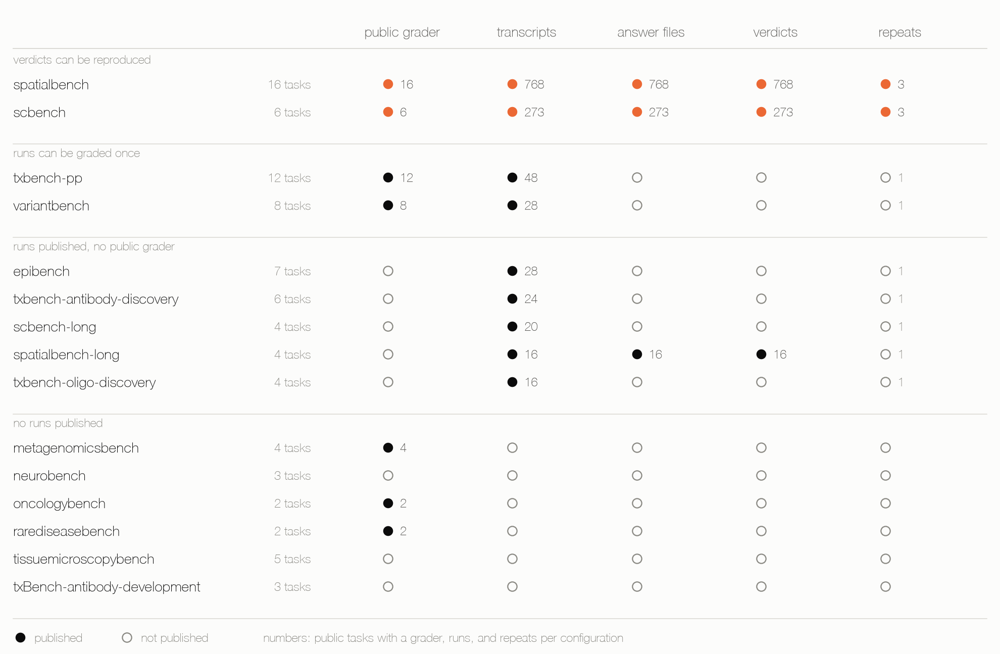

# The benchmark family: what is public, and what that lets an outsider check

Snapshot: 15 LatchBio benchmark repositories at the commits pinned in
`scripts/fetch_upstream.sh`, November 2026. The 6 biosecurity benchmarks
are left out on purpose. Every number here is copied from `results/family/`,
`results/variantbench/`, `results/txbench-pp/` or `validation/`, and
regenerates with the commands in section 6. Observations marked **[read]**
were read from transcripts by AI models and are not produced by the tool.

Nothing here was checked by a person. Section 5 lists what that leaves open.

## 1. An assay can be validated only as far as its controls ship with it

Whether an outside reader can reproduce a verdict, grade a run, measure
repeatability or trace a method depends on which files a benchmark
publishes. `sc-zprime inventory` counts them. It reads the structure of the
task files (keys, grader types, metadata labels) and never a prompt, a
reference value or an answer.

| Benchmark | Public tasks | With a public grader | Transcripts | Runs with a published verdict | Repeats |
|---|---|---|---|---|---|
| scbench | 6 | 6 | 273 | 273 | 3 |
| spatialbench | 16 | 16 | 768 | 768 | 3 |
| spatialbench-long | 4 | 0 | 16 | 16 | 1 |
| variantbench | 8 | 8 | 28 | 0 | 1 |
| txbench-pp | 12 | 12 | 48 | 0 | 1 |
| epibench | 7 | 0 | 28 | 0 | 1 |
| scbench-long | 4 | 0 | 20 | 0 | 1 |
| txbench-antibody-discovery | 6 | 0 | 24 | 0 | 1 |
| txbench-oligo-discovery | 4 | 0 | 16 | 0 | 1 |
| metagenomicsbench | 4 | 4 | 0 | 0 | n/a |
| oncologybench | 2 | 2 | 0 | 0 | n/a |
| rarediseasebench | 2 | 2 | 0 | 0 | n/a |
| neurobench | 3 | 0 | 0 | 0 | n/a |
| tissuemicroscopybench | 5 | 0 | 0 | 0 | n/a |
| txBench-antibody-development | 3 | 0 | 0 | 0 | n/a |

In all: 15 repositories, 86 public tasks, 1221 transcripts.



The same table as a picture. A filled mark means the repository publishes
that kind of file for its public tasks, and a ring means it does not. In the
last column a filled mark means 2 or more repeats per configuration. The
numbers are counts: public tasks with a grader, transcripts, answer files,
verdicts, and repeats per configuration. Orange marks the 2 repositories
whose verdicts can be reproduced.

- 2 repositories publish what it takes to reproduce a verdict and to measure
  repeatability: scbench and spatialbench. The rest of this project's results
  rest on them.
- 2 more publish a grader config for every public task and 1 transcript per
  configuration, so their runs can be graded from outside, once: variantbench
  and txbench-pp. Section 3 does that.
- 3 publish a grader for every public task and no runs: metagenomicsbench,
  oncologybench and rarediseasebench.
- 8 repositories publish no grader for their public tasks. One of them,
  spatialbench-long, publishes verdicts and answers all the same, so there
  is nothing to regrade.

This is a statement about what is public. Every repository publishes only a
sample. Some give the size of the full benchmark and others do not, and 4
(oncologybench, rarediseasebench, tissuemicroscopybench,
txBench-antibody-development) say in their READMEs that their public tasks
are not part of the benchmark but are built like its tasks. What the authors
hold back may be everything a validation needs. 5 of the 8 that publish no grader say so in a
`data_availability` field of each task file: the grader, its tolerances and
the held-out ground truth are withheld, to prevent training contamination
and to respect the source-data licences. 2 of the 5 add that the full
evaluation set is available to qualified partners. The other 3 (epibench,
scbench-long, spatialbench-long) do not say.

## 2. How the repositories differ in design

Read from the same repositories. Each repository is read at 1 pinned commit,
fetched without history, and all 15 commits are dated November 2026. So this
is a comparison across repositories, not a history: nothing here says which
design came first.

**One grader or many.** All 22 public tasks of scbench and spatialbench use
the numeric tolerance grader alone. In variantbench and txbench-pp, 8 of 20
public tasks use it alone. The other 12 use label sets, marker lists,
multiple choice, composites of those, or a list of graders, and 4 of the 12
include a numeric tolerance grader among them. 2 repositories with public
graders use rubrics (oncologybench, rarediseasebench). 5 repositories
withhold the grader and state its type in the task metadata; the types named
there include numeric ranges, predicates, composites, polygon overlap and an
event F1.

**Trap notes and a failure-mode taxonomy.** The 22 scbench and spatialbench
tasks describe their traps in prose design notes, and none carries a
failure-mode label. 20 of the 86 public tasks, in 5 repositories, carry a
label from a versioned taxonomy (v1.1.0 and v1.2.0) with 11 top-level
categories among them. In variantbench and txbench-pp the labels sit
alongside prose notes, which every task there still carries. The most common
labels are metric or statistic mismatch (7 tasks), biological interpretation
(6) and subset, scope or compartment (6). A label names the failure a task
is built to catch. A validation card measures whether the task's readout
catches it.

**Harness.** 237 of the 273 scbench runs and 672 of the 768 spatialbench
runs used mini-swe-agent. In the 7 other repositories with transcripts, 94 of
180 runs used pi, 80 used the vendors' own command lines (claude-code,
openai-codex) and 6 used mini-swe-agent. The evaluation tool stamped its
version on result files: 0.3.7 on 432 of the 768 in spatialbench (the other
336 carry none), 0.3.8 and 0.3.9 in scbench, 0.3.14 in spatialbench-long.

**What the public samples include differs.** scbench and spatialbench
publish answers, verdicts and 3 repeats. variantbench and txbench-pp publish
grader configs and 1 transcript per configuration. 5 repositories withhold
even the public tasks' graders, for the 2 reasons quoted in section 1.

That difference is the case for the validation card in this repository. The
less of a task is public, the less of its readout anyone outside can check.
A card is evidence about a task that can be published without its answer:
whether the controls separate, how many verdicts sit on an edge, whether
repeats agree.

## 3. A first grading of VariantBench and TxBench-PP

These 2 publish grader configs and transcripts, and no answers or
verdicts. `sc-zprime regrade` recovers the answer each run left behind from
its transcript and grades it with independent graders. VariantBench's README
says its public subset holds 8 evals, 2 of which (the neoantigen evals) sit
outside its main 118-eval benchmark. TxBench-PP's README speaks of 7 public
examples; its `evals/` folder holds 12 task files, and all 12 are used here.

**How far the recovery can be trusted.** 3 benchmarks publish each run's
answer next to its transcript, which makes them a test set: scbench,
spatialbench and spatialbench-long. On those 1057 runs the recovery finds an
answer for 1004, and 994 of the 1004 equal the published answer exactly. The
53 not recovered are reported as not recovered, not guessed. 11 recovered
answers carry a flag that the answer file was written again without showing
what was written, and only 4 of those 11 are right. So of the 993 recovered
answers without the flag, 990 were right.

The test set is not shaped like the runs graded here. 909 of its 1057 runs
used mini-swe-agent and 8 used pi, while 40 of the 76 runs graded here used
pi. On those 8 pi runs the recovery found all 8 answers exactly, which is a
small check. In the test set 926 of the 1004 answers were read from printed
output and 77 from a write to the answer file. Here 38 of 71 were read from
printed output, 29 from a write and 4 from a tagged message. Most test
answers are sets of numbers, while most answers here hold labels or lists.
So the recovery is measured, mostly not on runs like these, and its error
rate on these 2 benchmarks is not known. None of the 71 answers recovered
here carries the written-again flag.

**How far the grading can be trusted.** Less far. The numeric grader is
checked against 1041 published verdicts. No public run graded with a
published config of the other types carries a verdict: spatialbench-long
publishes verdicts, but not its grader. So the label-set,
marker-list, multiple-choice and composite graders are checked only against
unit tests written from a reading of the upstream source. Upstream's own
unit tests for them were read and not ported. A second AI model compared
each rule with the upstream source and ran 69000 generated answers through
these graders and through its own transcription of the upstream logic,
across the public configs, and found no difference in verdict. That is one
reading checked against another, not a run of the upstream code.

| | VariantBench | TxBench-PP |
|---|---|---|
| Public tasks, all gradable | 8 | 12 |
| Transcripts | 28 | 48 |
| Configurations, 1 repeat each | 5 | 4 |
| Answers recovered | 27 | 44 |
| Recovered answers that pass | 6 | 19 |
| Tasks that no recovered answer passed | 4 | 2 |
| Graded fields | 51 | 113 |
| Fields that fail | 29 | 42 |

These are counts on 1 repeat of 4 or 5 configurations. They are not rates,
they do not compare the 2 benchmarks, and they say nothing about any
model. 4 of the 6 VariantBench passes are on the 2 tasks that list several
graders, where counting a pass only if all of them pass is this project's
reading (section 5).

**Why fields fail.** Of the 71 failing fields, 69 fail on value and 2 on
form. The 2 are 1 run that wrote a sentence where a number was wanted. At
least 1 number inside each sentence would have passed. No run failed on form
alone, and no label failed only by case or spacing. On this sample the set
graders' exact-text rule did not decide a verdict.

**How settled each recovered answer is.** 69 of the 71 recovered answers are
the only answer object their transcript shows. In the other 2 the transcript
shows several, and in 1 of those they would not all get the same verdict.
The last one shown is taken, and the tables flag it.

**By failure-mode label.** All 12 TxBench-PP tasks carry labels, and 7 carry
more than 1. A task counts under each of its labels, so the rows overlap:
they add up to 21 tasks and 77 answers, from 12 tasks and 44 answers.

| Failure mode | Tasks | Answers recovered | Pass |
|---|---|---|---|
| metric_statistic_mismatch | 5 | 19 | 7 |
| biological_interpretation | 4 | 15 | 6 |
| causal_epistemic_overreach | 3 | 11 | 5 |
| marker_reference_label_scope | 3 | 12 | 6 |
| subset_scope_compartment | 3 | 12 | 5 |
| qc_control_artifact | 2 | 6 | 2 |
| replicate_unit_of_analysis | 1 | 2 | 1 |

With this few runs the rows cannot be told apart. A pass count says how
often these 4 configurations passed the tasks that carry a label. It does
not say whether those tasks catch the failure the label names. That needs
method labels, which these runs do not have. The table is here to show the
shape a card keyed by failure mode would take.

## 4. What a set grader cannot see: 2 cases

**An exact-match set grader scores every wrong set alike. [read]** One
VariantBench task grades a submitted set of labels by exact match, and its
notes say that rule is intended. 2 of the 4 runs submitted the same set for
the same stated reason, which the notes do not discuss. The other 2 runs
submitted a different set. All 4 fail that field, as the rule intends, and
the score does not say how a wrong set is wrong. One of the first 2 runs
printed a table that shows the feature the notes describe, and did not
remark on it. The other shows no check of that feature. Whether the reason
those 2 runs gave bears on the question is not something this project can
judge: no one working on it has seen the data.

**A higher bar for recall than for precision admits a long list.** Read from
the grader configs and the task notes, not from runs. The 2 neoantigen tasks
set a much higher bar for recall than for precision, so a list much longer
than the reference can still pass. Their notes state the precision bar and
the list length it rules out, so this is a stated design choice and not an
oversight. None of the 4 recovered answers on those tasks passes, and none
is much longer than the reference. A scripted over-long list would show on a
card how much room the choice leaves.

## 5. Limits

- No published verdict exists for these 76 runs. A mistake in answer
  recovery or in a grader would not show here.
- The recovery is measured mostly on runs from mini-swe-agent with numeric
  answers. 40 of the 76 runs here are from pi, and most graded fields are
  labels or lists. Recovery on runs like these is measured on 8 pi runs
  only.
- 2 VariantBench tasks give a list of graders in place of one. The public
  evaluation tool does not grade such a list. A validator in its types
  accepts a top-level `graders` list in place of `grader`, but its task
  model and harnesses read a single `grader`. It has a helper that runs each
  listed grader on the whole answer and returns the results side by side,
  and its composite grader describes a top-level list as the place for
  independent, partial-credit scoring. How those results become one verdict
  or reward is not in the public code. Here a run passes only if every
  listed grader passes. That reading is this project's, and 4 of the 6
  VariantBench passes rest on it.
- Run directories of TxBench-PP name an eval version, and the task files do
  not. Each run is graded against the task file at the pinned commit. If a
  task's grader changed after its runs, the grading here would not show it.
- 1 repeat per configuration. Nothing here speaks to repeatability.
- 5 of the 76 answers were not recovered and are left out of every count of
  passes and failures.
- The inventory counts public files. Withheld material is invisible to it.
- The 6 biosecurity benchmarks are not included.
- No method labels: these runs are graded, not traced.
- Checked by AI models only: one wrote the code and this page, others
  reviewed the graders against the upstream source, recounted the inventory,
  re-read the transcripts behind section 4 and tested what the tables give
  away about the tasks. Their corrections are in this version. No person has
  checked any of it.

## 6. Reproduce

```bash
scripts/fetch_upstream.sh ../upstream
sc-zprime inventory --upstream ../upstream --out out/family --skip biosecbench- --skip eval-graders --skip latch-eval-tools --figures
sc-zprime regrade --upstream ../upstream/variantbench --out out/variantbench --name variantbench
sc-zprime regrade --upstream ../upstream/txbench-pp --out out/txbench-pp --name txbench-pp
scripts/answer_recovery_check.py ../upstream
```

If something here misreads a repository, a task or its notes, please open an
issue. It will be fixed and the fix noted.
