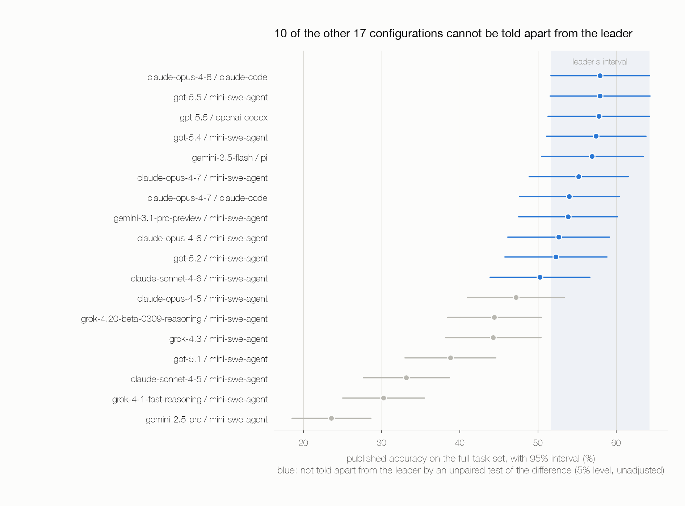

# Findings: the public scBench sample

Snapshot: upstream `latchbio/scbench` at commit `106726f` (16 November 2026).
Every number here is copied from `results/scbench/` and regenerates with
`sc-zprime run`, with one class of exception. Observations marked **[read]**
come from intermediate steps of transcripts: what a run printed along the
way, not what it submitted. They were read by an AI model, are not produced
by the tool, and were not part of the blind check. Section 8 says how the
rest was checked, and what was not checked.

## Evidence base

| | |
|---|---|
| Tasks | 6 public example tasks, one from each of the benchmark's six categories |
| Runs | 273 graded runs with full transcripts |
| Configurations | 16 model and harness pairs, from four providers and three harnesses |
| Cells | 91 task and configuration pairs, each with 3 repeats. Five tasks have all 16 configurations; the cell typing task has 11 |
| Grader | numeric tolerance on all six tasks; every graded field must pass |
| Graded fields | 13: 11 with a tolerance window and 2 exact-match multiple choice |

The six tasks are examples chosen by the benchmark authors. They are not a
random sample of the 195-task benchmark, whose other tasks are withheld to
prevent contamination. Rates measured here describe these six tasks and
these 16 configurations. They are not estimates for the benchmark.

Runs are not independent observations. Three repeats share a configuration,
and configurations share a provider. Intervals below are 95% cluster-bootstrap
percentile intervals that resample whole configurations, and counts are given
in configurations as well as runs.

Read those intervals as approximate, and probably too narrow:

- They rest on 16 configurations, or 8 or fewer for a rate about one method.
  A simulation with clusters sized like these (`scripts/interval_coverage.py`)
  finds that the nominal 95% interval covers the truth about 89% of the time.
- They treat configurations as independent, though many share a recipe, and
  with it an answer, across models and providers.
- They hold the six tasks fixed.
- Where every configuration agrees, a bootstrap returns one value every time
  and cannot give an interval. An exact one-sided bound, counted in
  configurations, is given instead. Where fewer than three configurations
  stand behind a number, no interval is given.

Distances are **margins**: the signed distance of a submitted answer from the
reference, in units of the tolerance width on that side. Zero is the
reference. Plus and minus one are the edges of the pass window.

## 1. The published verdicts are reproducible

The grader in `src/sc_zprime/graders.py` was written after reading the
upstream grader, in separate code, without importing it. It mirrors the
upstream behaviour, including which configurations are rejected. It agrees
with the published result on:

- 273 of 273 run verdicts
- 594 of 594 field-level verdicts (one per run and graded field)

across grader versions 0.3.8 and 0.3.9. Deterministic code grading delivers
what it promises: a third party can recompute every verdict from the answer
file and the task file.

These 273 runs exercise only absolute tolerances on well-formed answers. The
remaining behaviour (relative, minimum and maximum tolerances, malformed
answers, invalid configurations, floating-point results exactly at an edge) is
pinned by unit tests written from the upstream source, not by published runs.

## 2. The pass window as a test of method

For three tasks, each submitted answer was traced to the code that produced
it and labelled with the method used. The labels were then checked by blind
raters, which were AI models (section 8). Each method has a tier:

- **intended**: what the task's design notes call the correct approach
- **trap**: what the notes name as an incorrect approach
- **partial** and **other**: methods the notes do not mention. These two
  tiers are this analysis' labels, not the authors'.

The pass window can then be scored like a diagnostic test. **Sensitivity** is
the share of intended-method runs that pass. **Specificity** is the share of
trap-method runs that fail.

| Task | Sensitivity | Specificity | Trap runs that pass, by configuration |
|---|---|---|---|
| Differential expression | 17 of 17 | 7 of 20 (35%, interval 19% to 53%) | 7 of the 8 configurations that submitted a trap method passed at least once |
| Normalization | 29 of 29 | 17 of 17 | 0 of 8 |
| PCA preprocessing | 5 of 5 | 43 of 43 | 0 of 15 |

Sensitivity is 100% on all three, with a caveat for each: on differential
expression all 17 intended runs used one tool (DESeq2), on normalization all
29 used one recipe, and on PCA preprocessing the 5 intended runs come from one
model under two harnesses.

A rate of 100% from a handful of configurations bounds the truth only
loosely. Counted in configurations the three sensitivities are 7 of 7, 13 of
13 and 2 of 2, for which the exact one-sided 97.5% lower bounds are 59%, 75%
and 16%. The two perfect specificities are 8 of 8 and 15 of 15
configurations, with lower bounds of 63% and 78%.

### Z-prime, one named trap at a time

Z-prime summarises how far apart two sets of answers are, relative to their
scatter. It is computed here in its classic form (means and standard
deviations) between the intended-method answers and each named trap method
separately, since each trap is its own negative control.

It needs a caution that a plate assay does not. The statistic was built for
readouts that scatter smoothly around two means, and for a one-sided hit
threshold. Benchmark answers do neither: runs that follow one recipe submit
one identical value (section 3), and a pass window has two edges. So Z-prime
is a rough summary here, and it can mislead in both directions:

- **A negative value without overlap.** On differential expression the
  rank-test Z-prime is -1.04, yet no rank-test answer lies among the
  intended-method answers. It is negative because the rank-test answers fall
  in several clusters spread over four tolerance widths, on both sides of the
  intended ones, which makes their standard deviation large.
- **A perfect value without distance.** On normalization Z-prime is 1.00
  because neither control has any spread. The nearer trap sits only 0.6
  tolerance widths from the intended answer.

Whether a pass window can separate two methods is therefore read from the
margins, in the sections for each task below. Z-prime is reported next to
them, not instead of them.

| Task | Trap method | Runs | Pass | Z-prime | 95% interval |
|---|---|---|---|---|---|
| Differential expression | per-cell rank test | 19 | 13 | -1.04 | -1.57 to 0.27 |
| Differential expression | per-cell t-test | 1 | 0 | not estimable (one run) | |
| Normalization | log-normalise, then dispersion-based selection | 13 | 0 | 1.00 | none: no spread within either method |
| Normalization | dispersion-based selection on raw counts | 4 | 0 | 1.00 | none: almost no spread within either method |
| PCA preprocessing | genes scaled, depth not regressed | 35 | 0 | 0.29 | none: the intended control comes from two configurations |
| PCA preprocessing | PCA with neither step | 8 | 0 | 0.21 | none: the intended control comes from two configurations |

By the usual convention 0.5 or above is an excellent assay and 0 to 0.5 is
marginal. Below 0 the scatter bands of the two controls, three standard
deviations each, overlap. The rank-test interval rests on 7 configurations
for the intended control and 8 for the trap. Z-prime was below zero in 93% of
the bootstrap resamples, which describes the resampling and is not a
probability, and it stays between -1.48 and -0.74 when any one provider is
left out. On PCA preprocessing the window rejects every trap run even though
Z-prime is only marginal, because the trap answers are far from the window
but widely scattered.

An earlier version of this analysis pooled all trap methods into one negative
control and used medians and MADs. That statistic is unsound here: traps are
designed to miss on opposite sides of the window, and when more than half of a
control submits one value its MAD is zero whatever the rest did. It is kept
only in `results/scbench/sensitivity.csv`.

### Differential expression: the per-cell rank test passes

The task asks for the number of differentially expressed genes between two
conditions in one cell type, across donors. Its notes say it tests whether
the agent aggregates to pseudobulk and models donor as a covariate, instead
of treating individual cells as independent observations. Their primary trap
is per-cell testing with scanpy's default tools. They record a value for its
default t-test, far above the window, and one for the Wilcoxon rank test,
below it, and their list of incorrect approaches adds any other method that
treats cells as independent.

| Method | Tier | Runs | Pass | Configurations (with a pass) | Median margin |
|---|---|---|---|---|---|
| Pseudobulk DESeq2, donor in the design | intended | 17 | 17 | 7 (7) | +0.51 |
| Pseudobulk DESeq2, no donor term | partial | 9 | 0 | 4 (0) | +1.03 |
| Per-cell rank test | trap | 19 | 13 | 8 (7) | -0.93 |
| Per-cell t-test | trap | 1 | 0 | 1 (0) | +7.1 |
| Pseudobulk paired t-test, hand-rolled | other | 2 | 0 | 1 (0) | +8.2 |

**The default t-test fails as the notes expect.** One run submitted it and
landed far above the window. One run is too few to estimate anything.

**The rank test passes two times in three.** It is the per-cell method agents
actually reached for: 19 runs against 1. Thirteen of the 19 passed, from seven
configurations and all four providers. Their answers form clusters at margins
-0.93 (six runs) and -0.27 (five runs), with single runs at -0.89 and +0.77.
The other six rank-test runs fall between -3.3 and -1.1 and fail. The value
the notes record for this method is at margin -1.5, outside the window. The
agents' versions of it land higher. This analysis does not establish why.

**How much of this is the window, and how much the readout.** No trap answer
falls inside the band occupied by intended-method answers, which is 0.19
tolerance widths wide. The nearest is 0.07 widths away. So a window drawn
tightly around the answers these 17 runs gave would have separated the two
methods in this sample. The actual window is two widths wide for a reason the
notes give: it is sized to admit other donor thresholds, gene filters and
pseudobulk tools, and the pseudobulk values they list run from margin -0.68 to
+0.91. Narrowing the window to that range would turn seven of the thirteen
trap passes into fails. The other six, at -0.27 and +0.77, sit inside the
range the notes accept, so no choice of edges that admits the accepted
variants can reject them. Those six come from three configurations. A count
of significant genes is a readout that different methods can reach by
different routes.

**Pseudobulk without a donor term fails by a hair.** Nine runs aggregated
correctly and left donor out of the model. All nine submitted the identical
value, 0.03 tolerance widths past the upper edge. The notes require donor as
a covariate, so this is not their intended method, but they never mention
this design: it is not in their list of incorrect approaches and they give no
value for it. Whether the window was meant to reject it is not stated. Other
DESeq2 settings that agents tried along the way printed counts between +0.62
and +1.11, with no-donor variants on both sides of the edge and one
donor-design variant outside it **[read]**. Which side a pseudobulk DESeq2
analysis lands on depends on settings the task does not specify.

**Three of those nine had the intended answer in hand.** The tool flags them
as having run an intended method at another step, and the blind raters
confirmed it. Their transcripts show the donor design being run and its
result printed, the same value the intended-method runs submitted **[read]**.
They submitted the no-donor result.

A readout that might separate the methods better: the count restricted to
genes that stay significant under a donor-aware model, or a statistic computed
on the pseudobulk matrix itself. This is a suggestion for discussion, not a
tested fix.

### Normalization: clean separation among submitted answers

Every submitted intended-method answer passes and every submitted trap answer
fails. Three details qualify it.

- **One recipe carries the task.** All 29 passing runs used variance-stabilised
  gene selection on raw counts and submitted the identical value, at margin
  -0.82. The notes anticipate this. They give the same distance from the
  edge, they record that the window was widened to take in all depth-aware
  methods with more room, this one among them, and they state under
  limitations that the task cannot distinguish an agent that reasons about
  sequencing depth from one that uses a good default. They predicted a pass
  rate of 70 to 100%. The measured rate is 60% (29 of 48 runs, interval 42%
  to 79% over configurations), which does not rule out the lower end of
  their range.
- **The reference was computed and not chosen.** No run submitted an answer
  from the method the reference value was computed with, and the nearest
  submitted answer is 0.82 tolerance widths from it. But four runs, all from
  one model, ran that method on the way and printed a value within 0.01
  tolerance widths of the reference **[read]**. They then submitted the
  variance-stabilised number, which the notes also accept. The reference
  reproduces in the task environment.
- **One named trap was never submitted, and would have passed.** The notes
  list log-normalisation followed by the cell_ranger selection flavour as
  incorrect and expect it near the other log-normalised answer, below the
  window. At least 13 runs from 7 configurations computed it while comparing
  options, and each printed a value inside the window **[read]**. None submitted it. The separation measured here is between the
  recipes agents chose to submit, not between every method the notes accept
  and every method they reject.

Two runs applied the variance-stabilised method to data that had already been
normalised. The notes do not list that variant by name, though their last
item rejects any pipeline built on that normalisation, which plausibly covers
it. It is tiered "other" here as the cautious choice. Both failed.

### PCA preprocessing: the designed trap catches almost everyone

Five runs regressed out sequencing depth and scaled genes before PCA. All
five passed. Forty-three runs skipped one or both steps and all failed.

The notes design this task around two decisions, one graded field for each,
and say plainly that the traced field is blind to the scaling decision on
purpose: the other field catches that. They also predicted what the runs show.
Their primary trap is an agent that scales and runs PCA out of habit, computes
the depth diagnostic on its own embedding, sees it high, and submits anyway.
Thirty-five of the 43 trap runs are exactly that recipe. Ten of the 43 ran the
regress-and-scale pipeline at some step and submitted the other pipeline. In
the nine of those that were read in full, the run printed a depth correlation
inside the pass window first **[read]**.

Two things a reader should know about the five passing runs. They come from a
single model under two harnesses. And none of them is the reference recipe:
all five regress out the log of total counts, where the reference regresses
out total counts. The notes accept any pipeline that neutralises per-cell
depth variance; reading that as covering both is this analysis'
interpretation.

One open question for the task's authors, offered as a question. The notes do
not claim depth regression is a general rule. They say it is often treated as
optional and argue, with measurements, that it is required on this sample,
where sequencing depth differs several-fold between cell compartments. The
reference pipeline matches scanpy's legacy PBMC 3k tutorial on both steps,
while scanpy's current preprocessing and clustering tutorial takes neither,
so two official recipes land on opposite sides of the verdict. The notes
describe the PBMC 3k tutorial as omitting the regression step. The legacy
PBMC 3k page includes it, so the notes may have a different page in mind.
Both pages were fetched and read by an AI model in November 2026:
[legacy workflow](https://scanpy.readthedocs.io/en/stable/tutorials/basics/clustering-2017.html),
[current tutorial](https://scanpy.readthedocs.io/en/stable/tutorials/basics/clustering.html).
With 15 of 16 configurations submitting a trap pipeline at least once, a
reviewer with single-cell experience might confirm that the task separates
judgement on this dataset from recall of one convention.

## 3. Edge sensitivity

Each run was regraded with every tolerance multiplied by a scale factor.
Tightening can only turn passes into fails, and widening only the reverse. One
field has a window whose floor is zero by design; that floor is left in place
and only its upper edge is moved.

| Tolerance scale | 0.5 | 0.75 | 0.8 | 0.9 | 1.0 | 1.1 | 1.25 | 1.5 | 2.0 |
|---|---|---|---|---|---|---|---|---|---|
| Pass rate, all runs | 20.9% | 30.4% | 30.8% | 41.8% | 48.7% | 53.1% | 55.7% | 61.5% | 67.0% |

**68 of 273 verdicts (24.9%, interval 20% to 30%) flip if tolerances are made
20% tighter or 25% wider**: 49 passes that would fail and 19 fails that would
pass. Of the 68, 29 are one recipe on the normalization task, which the notes
place at that distance from the edge on purpose (below). The share depends on
how far the edges are moved: 8% at plus or minus 5%, 11% at 10%,
33% at one third tighter or half wider.

The reason is that answers are not noise around a centre. A deterministic
pipeline gives the same number whoever runs it. On the eight tolerance-window
fields that are not dead readouts (section 5), **53% of answers (203 of 384)
belong to a group of three or more runs that submitted the identical value**,
usually from different models and providers. So a window edge does not trim a
distribution. It decides which recipes count.

The task authors design their windows on exactly that basis. Their notes list
which recipe gives which value and reason about each recipe's distance from
the edge. What the public runs add is where the recipes agents actually used
ended up:

| Task | Cluster | Margin | Verdict on that field |
|---|---|---|---|
| Normalization | 29 runs, 13 configurations | -0.82 | pass |
| QC | 13 runs, 9 configurations | inside, near the upper edge | pass |
| Differential expression | 9 runs, 4 configurations | +1.03 | fail |
| Differential expression | 6 runs, 4 configurations | -0.93 | pass |
| QC | 4 runs, 4 configurations | above, near the edge | fail |

The normalization cluster sits where the notes say it would. The larger QC
cluster sits just inside the upper edge of one field. That field is a whole
number with a small tolerance, so its margins are given as zones and not as
numbers (see [DATA_POLICY.md](DATA_POLICY.md)).

The QC notes belong here too. They accept running no cell filter at all on
this gene panel, and they document one near-miss the grader cannot see: a
mitochondrial filter that removes nothing lands on the reference with the
wrong reasoning. They judge it harmless for the biology.

## 4. Repeatability

| | |
|---|---|
| Cells (task and configuration, 3 repeats each) | 91 |
| Passed all three repeats | 28 |
| Failed all three repeats | 30 |
| Split | 33 (36%, interval 28% to 45%) |
| Submitted the identical answer all three times | 22 (24%) |

In more than a third of cells the verdict depends on which repeat is read.
Per task the split share runs from 6% (1 of 16 cells, PCA preprocessing) to
56% (9 of 16, clustering). Answers are compared after rounding to six
decimals, so one result printed with different float noise counts as
identical.

### The same quantity, inferred for the full benchmark

The published leaderboard gives each configuration's accuracy over 195 tasks
with a 95% interval. The metadata of the category and platform results files
describe the interval as a t-distribution interval over per-task means, with
three runs. Under that description the two published numbers determine how
often repeats disagree, without the per-task results.

A task's mean over three runs, m, is 0, 1/3, 2/3 or 1. The quantity
`m (1 - m)` is 2/9 for the two split outcomes and 0 for the two unanimous
ones. Its average over tasks equals `p (1 - p) - V`, where p is the accuracy
and V is the population variance of per-task means, which the interval width
gives. So

    share of tasks with split repeats = 4.5 * (p (1 - p) - V)

This is an identity for three pass or fail runs on every task, not an
approximation. The test suite checks the algebra on simulated benchmarks, on
simulated benchmarks rounded to two decimals as published (error under one
percentage point), and on the public runs, where the split share is known.
That last check builds its own interval, so it confirms the algebra and says
nothing about how upstream built theirs.

Across the 18 configurations with a published interval, the inferred share of
tasks whose three repeats are not unanimous has a **median of 21%, range 15%
to 34%**. The chance that a single rerun gives a different verdict from a
given run is then estimated at two thirds of that: about 14%, or one task in
seven.

This is an inference, not a measurement. It assumes that every run is scored
pass or fail, that the accuracy is the plain mean of per-task means, that
every task has exactly three runs, and that the interval was built as the
metadata say, from the sample standard deviation. None of that could be
checked against code. Two things support it: every published accuracy is a
whole number of passes out of 585 runs, to within rounding, and using a
normal multiplier or a population standard deviation instead moves the
inferred share by about one percentage point.

## 5. Dead readouts

A dead readout is a graded field that at least 95% of runs pass. Four of 13
fields qualify:

| Task | Field kind | Pass rate | Verdicts it decided alone |
|---|---|---|---|
| Normalization | data summary | 48 of 48 | 0 |
| Normalization | data summary | 48 of 48 | 0 |
| Cell typing | count | 32 of 33 | 1 |
| Clustering | multiple choice | 48 of 48 | 0 |

On two of these fields all 48 runs, from the weakest model to the strongest,
submitted the same value. The cell typing count did change one verdict, so
"dead" means rarely decisive, not never.

Under all-or-nothing grading such a field costs nothing. The normalization
notes describe their two as scaffolding, there to make the agent inspect the
data before choosing a method, which is a reasonable design. The notes for the
other two tasks do not describe their fields that way, and nothing here says
they should be removed.

The effect shows under partial credit, where each field earns a share of the
score:

| Task | Strict pass rate | Partial credit | Partial credit, fields below 95% only |
|---|---|---|---|
| Normalization | 60.4% | 86.8% | 60.4% |
| Clustering | 31.3% | 65.6% | 31.3% |
| Cell typing | 54.5% | 77.3% | 57.6% |

A run that fails the one field that tests the skill still collects two thirds
of the points on the normalization task. If fields are ever averaged, the
weights matter.

## 6. How well the leaderboard resolves

The repository's `results/model_results.csv` is the table the upstream README
heads "June 2026 results snapshot". Current rankings are on the benchmark's
website and may differ. Of its 19 configurations, 18 have an interval. Two
tie for first.

- Median half-width: 6.3 percentage points.
- By an unpaired test of each difference at the 5% level, 10 of the other 17
  configurations cannot be told apart from the leader, and 76 of 153 pairs
  cannot be told apart from each other.
- Counting overlapping intervals instead, a looser criterion, gives 11 of 17
  and 93 of 153.

Three cautions. The test recovers each standard error from the published
interval, so it shares the assumptions listed in section 4. It makes no
adjustment for testing 153 pairs, which errs towards telling configurations
apart. And it is unpaired: every configuration ran the same tasks, so a
paired comparison task by task would separate more of them. That needs
per-task results for each configuration, which the repository does not
publish for the full benchmark. As it stands the table supports a few groups
with unclear order inside each, not a strict ranking.

## 7. Fifteen runs ran the intended method and submitted another

Fifteen traced runs executed an intended method at some step and then
submitted a number from a different method: 3 on differential expression, 2 on
normalization, 10 on PCA preprocessing. Blind raters confirmed all fifteen.

For the PCA task this is the behaviour the notes set out to catch, and the
grader catches it. On differential expression a numeric grader scores these
runs the same as a run that never tried the right method.

A separate observation, not among the fifteen: four normalization runs
computed a value within 0.01 tolerance widths of the reference and submitted
a different accepted answer, which passed **[read]**. That is a choice
between two methods the notes accept, not a wrong turn.

Fifteen runs on three tasks are too few to generalise from. They are reported
because a grader that sees only the final number cannot see them.

## 8. How this was checked

Every check below was carried out by AI models, in sessions separate from the
one that wrote the code. So were the method specs and the four labels set by
reading. No person has yet checked a sample of the labels or the numbers.
That is the most useful check still outstanding.

**Method labels: blind re-rating.** AI raters, with no access to the tracer,
its output, the task notes or any verdict, read the transcripts and labelled
the method behind all 144 traced runs from a fixed list of labels. The 48
differential expression runs were each labelled twice. That is 192 ratings,
and every one agreed with the tool: 144 of 144. The list of labels was
written for this analysis, so the raters were blind to the tool's answers,
not to its vocabulary. On a second question, whether a run had also executed
an intended method elsewhere, the raters found two cases the tool had missed;
the detector was corrected and the count rose from 13 to 15. Four labels were
set by reading the transcript in full, not by rule, in an earlier version,
three of them changing a run's tier. The blind raters, who never saw those
labels, reached the same ones. Protocol and table: `validation/`.

**Numbers: independent recomputation.** Ten passes recomputed the statements
in the first draft of these documents from the raw upstream files with their
own code, about 1,100 statements in all. They reported 58 problems, most of
them wording that was imprecise or unfair to the task authors, and several
counts that were wrong. Four further passes compared every statement about
the authors' notes with the notes themselves. The corrections are
incorporated.

**Statistics review.** A later pass reviewed the uncertainty code and every
statistical statement. It found no arithmetic error and several faults of
interpretation, now corrected: Z-prime was described as if a negative value
meant the answers overlap; perfect rates were printed with intervals of zero
width; intervals were quoted without saying how few configurations stand
behind them; and overlap of intervals was used where a test of the difference
was needed.

**Review from the authors' side.** Another pass read every document as a
member of the benchmark's team would, against the task notes. It found that a
draft misdescribed the differential expression task's primary trap, credited
a documented design choice as a finding, and left out that the checkers were
AI models. Those are corrected, and a validation card now says where a flag
matches something the notes already explain.

**Documents against data.** `tests/test_docs_numbers.py` rebuilds each
headline sentence of the README and of this document from the result tables,
and fails if a number or its wording has drifted.

**Reproduction.** A clean-room reproduction of the first draft, from a fresh
clone in a new environment, regenerated every table, card and summary byte
for byte across Python 3.10 to 3.14. It also found that an installed copy
silently dropped the four labels set by reading, which is fixed: they now ship
with the package. The same regenerate-and-compare check runs in CI.

**Code review.** Three of seven planned passes ran: grader equivalence, and
the statistics module twice. Their main findings are fixed and pinned by
tests.

**Not done.** A check of a sample of labels and numbers by a person. Code
review of the transcript parser, the method tracer, the tests and the report
writer. The observations marked **[read]** were read once and not repeated
independently. The Z-prime thresholds were confirmed against secondary
summaries of Zhang, Chung and Oldenburg (1999), not against the paper itself.

## Limits

- **Six tasks, sixteen configurations.** Chosen as examples by the authors.
  Nothing here generalises to the withheld tasks.
- **No new runs.** No model was run and no dataset was downloaded. Reference
  values are taken as given.
- **Tiers lean on the notes.** Intended and trap tiers follow the authors'
  notes. Partial and other are labels of this analysis. The notes accept
  methods no run used (edgeR, limma, scran, SCTransform, scVI); the rules
  would not recognise all of them.
- **Submitted answers only.** Specificity is measured on what agents chose to
  submit. The normalization task shows why that matters: a named trap that
  nobody submitted lands inside the window when run.
- **Tracing is rule based.** 133 of 144 labels come from finding the submitted
  value in a step's output, 7 from the last classifiable step, 4 from reading.
  All 144 match the blind raters.
- **Small controls.** The PCA positive control is 5 runs from one model.
  Z-prime for the per-cell t-test cannot be estimated from one run.
- **Z-prime is a loose fit.** It assumes smooth scatter and a one-sided
  threshold. Answers here come in clusters and windows have two edges
  (section 2).
- **Intervals are approximate.** Few configurations, treated as independent,
  with the tasks held fixed (Evidence base).
- **Agent answers stand in for controls.** A proper Z-prime uses scripted
  controls: the reference pipeline and each named trap, run on purpose. That
  needs the task data and is the next step.
- **One grader type.** Only numeric tolerance is re-implemented. Tasks with
  other graders are skipped and listed.
- **Thresholds are choices.** The 0.8 and 1.25 edge scales, the 95% cut-off
  and the cluster size of three were fixed before looking at results but are
  still choices. `results/scbench/sensitivity.csv` shows each result under
  alternatives.
