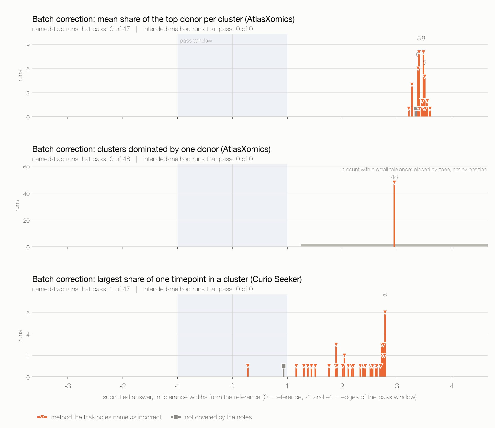

# Findings: the public SpatialBench sample

Snapshot: upstream `latchbio/spatialbench` at commit `baa9841` (1 November
2026). Every number here is copied from `results/spatialbench/` and
regenerates with `sc-zprime run`, with 2 classes of exception. Observations
marked **[read]** come from intermediate steps of transcripts: what a run
printed or wrote along the way, not what it submitted. They were read by AI
models and are not produced by the tool. Observations marked **[count]**
come from `scripts/closing_messages.py`, a keyword match whose table is in
`validation/spatialbench_closing_messages.csv`.

Nothing here was checked by a person, and the method labels on this page
have not been through the blind re-rating that the scBench labels had.
Section 5 lists what was checked, by which kind of reviewer, and what that
leaves open.

## 1. Evidence base

| | |
|---|---|
| Tasks | 16 public example tasks, from the benchmark's 7 categories and 5 platforms |
| Runs | 768 graded runs with full transcripts |
| Configurations | 16 model and harness pairs, from 4 providers and 3 harnesses |
| Cells | 256 task and configuration pairs, each with 3 repeats |
| Grader | numeric tolerance on all 16 tasks; every graded field must pass |

The 16 tasks are examples chosen by the benchmark authors. They are not a
random sample of the 159-task benchmark, whose other tasks are withheld to
prevent contamination. Rates measured here describe these 16 tasks and these
16 configurations. They are not estimates for the benchmark.

No model was run and no dataset was downloaded. The tool that produced the
scBench results reads this checkout with one change: SpatialBench keeps its
task files in `example_evals/` where scBench uses `evals/`.

Distances are given in tolerance widths: 0 is the reference value and 1 is
the edge of the pass window.

## 2. The same checks as scBench

| Question | Result |
|---|---|
| Are the published verdicts reproducible? | Yes. The independent grader agrees on 768 of 768 run verdicts and 1871 of 1871 field-level verdicts. |
| How many runs pass? | 124 of 768 (16%). 6 of the 16 tasks were not passed by any run. |
| Do verdicts sit near an edge? | 25 of 768 verdicts (3%) flip if every tolerance is made 20% tighter or 25% wider. 7 of the 39 graded fields are exact-match and cannot flip. On 9 whose lower edge is at or below zero, only the upper edge moves. |
| Do verdicts repeat? | In 46 of 256 pairs (18%) the 3 repeats did not get the same verdict. In 197 of 256 they did not submit the same answer. |
| Are there dead readouts? | 10 of 39 graded fields are passed by at least 95% of runs: 4 exact-match answers that nearly every run got right, 4 ceiling checks whose lower edge is at or below zero, and 2 two-sided windows. |
| How well does the published table resolve? | On the 159-task table in the repository, 11 of the 19 other configurations cannot be told apart from the leader by an unpaired test at the 5% level, with no adjustment for 19 comparisons. |

All configurations in that table ran the same tasks, so a paired test would
probably separate more of them. It needs per-task results for each
configuration, which the repository does not publish.

The edge and repeat shares are lower than on the scBench sample, for
different reasons. The repeat share is lower mostly because 6 of the 16
tasks were failed by every run. On the 10 tasks that at least 1 run passed,
46 of 160 pairs split (29%), against 33 of 91 on the scBench sample (36%).
The edge share is not explained that way: on those 10 tasks 25 of 480
verdicts flip (5%), against 68 of 273 (25%) on scBench. Both are comparisons
between 2 small samples that the authors chose, and neither is evidence
about how windows are placed across either benchmark.

2 of the dead readouts are a variable-gene count that the task notes call
diagnostic, with a window wide enough that it is not meant to decide a
verdict.

## 3. One decision, tested by 3 tasks, and no run submitted it

3 of the 16 tasks ask for a clustering of a multi-sample dataset and for a
number that says how far the clusters follow sample identity. 2 are on a
human dorsal root ganglion dataset from 8 donors: `NORM01_batch_correction`,
called the donor-share task below, and `DR01_batch_confounded_clustering`,
the cluster-count task. 1 is on a mouse ovary time course of 8 samples:
`curio_ovary_batch_driven_clustering`, the ovary task. Their notes say what
is being tested: whether the agent applies batch correction before it
clusters. The prompts ask for the clustering and the number. One explains
what the number measures, one states that the samples were merged without
integration, and none asks for a correction. The ovary task's notes say the
agent must infer that integration is needed. The notes of the 2 donor tasks
say that the test is whether the agent applies batch correction, and both
list no correction as the first common trap. Both predict a naive answer
above the window, and one says outright that the naive agent runs without
batch correction.

Each run was labelled by rule (`sc_zprime/methods/spatialbench.py`) from the
code of one step. For 72 runs that is the step that printed the submitted
number. For 70, among them all 48 on the cluster-count task, it is the last
classifiable step, because the submitted value could not be matched to a
printed one. 2 were labelled by reading. The label says what was done about
the sample:

| | Runs | Pass |
|---|---|---|
| A batch-correction method before clustering (the intended method) | 0 of 144 | n/a |
| No sample handling (the notes' first named trap) | 142 of 144 | 1 |
| Variable genes chosen per sample, nothing else corrected | 2 of 144 | 1 |



In the middle panel the readout is a count with a small tolerance, so its 48
answers are drawn by zone and not by position: all of them are above the
window and clear of its edge.

Read as an assay:

- **The negative control almost always falls outside the window.** Of the
  142 runs with no sample handling, 141 fail. Of the 2 that chose variable
  genes per sample, 1 fails. No run in either group submitted a corrected
  answer. On the donor-share task every answer sits at least 3.2 tolerance
  widths above the reference. On the cluster-count task every answer is
  above the window and clear of its edge; that field is a count with a small
  tolerance, so its distances are published as zones and not as numbers. The
  notes predict this: both put a naive agent's answer above the window.
- **The published runs hold no positive control.** No run submitted a number
  from a corrected pipeline, so the published runs cannot show whether a
  corrected pipeline passes in the agent environment. The task notes do list
  passing values for a corrected pipeline: at 3 resolutions on the 2 donor
  tasks, and as a range across methods on the ovary task. Those come from the
  authors' own analysis, and no published agent run can be set beside them.

So on these 3 tasks the published runs give a negative control and no
positive one. The 3 windows reject 142 of the 144 uncorrected answers that
16 configurations from 4 providers produced. Whether it accepts a corrected
answer from an agent is not tested by these runs. The validation cards flag
this as `NO_POSITIVE_CONTROL_IN_RUNS`. The 16 configurations are not
independent draws: they come from 4 providers, and 14 of the 16 share one
harness.

## 4. What the transcripts show

**Many runs name the batch effect in their last message.** **[count]** On
the 2 donor tasks, the last stored message of 22 of 48 runs on one and 13 of
48 on the other names a batch effect or a missing integration. The matches
are not spread evenly across providers, and most of that follows from what
the transcripts store: 72 of the 96 runs store any assistant text, and the
median length of the last stored text ranges from under 100 to over 700
characters by provider (`validation/spatialbench_closing_messages.csv`). A
last text that is only the answer cannot name anything, so this count says
nothing about which models noticed the batch effect. The first of the 2
prompts explains how to read the number, so naming a batch effect there may
echo the prompt. The second prompt does not mention batch effects, so the 13
matches on it are not an echo of the prompt, and all 13 runs still submitted
the uncorrected number. 2 more limits: in some transcripts the last stored
text is an opening plan and not a closing message, and a match does not
prove the sentence is about the submitted number.

**2 runs ran a correction, then submitted the uncorrected number.**
**[read]** One run on each donor task, the same model in the same harness,
ran a correction method at some step:

- On the cluster-count task it tried Harmony first, which failed (see
  below). It then ran BBKNN, pinned an older Harmony release and ran
  Harmony. Both printed values would have passed. The Harmony value came
  from a run capped at 5 iterations that stopped before convergence. The run
  then went back to an uncorrected pipeline and submitted that. The
  transcript gives no reason.
- On the donor-share task it also tried Harmony first, which failed, and
  fell back to BBKNN. The printed value sits 2.35 tolerance widths above
  the reference, outside the window. The agent wrote that the task had not
  asked for batch correction, went back to the uncorrected pipeline and
  submitted that.

Those 3 unsubmitted numbers are the only corrected answers anywhere in
the 144 transcripts. 2 would have passed. 1, from a correction method
the notes do not list a value for, would not.

**Harmony was not installed in the environment of the 2 runs that tried
it.** **[read]** The notes derive the 2 donor-task references with Harmony
and use Harmony as the benchmark method on the ovary task. The 2 runs that
tried Harmony are the same 2 runs described above. Their own logs date both
to 27 April 2026:

- On the donor-share task the run installed a different package,
  harmony-pytorch, then called Harmony through scanpy and got an import
  error: `harmonypy` was not there.
- Both runs then installed `harmonypy` and got release 2.0.0, and both
  failed with the same error inside scanpy's Harmony wrapper: the corrected
  matrix came back with the wrong shape.
- The run on the cluster-count task then pinned release 0.0.9, and Harmony
  ran.

2 other sources agree. 2 other runs in the same harness printed the image's
own dependency file (`/root/pyproject.toml`) on 15 April 2026, 12 days
before the 2 runs above. It lists BBKNN and Scanorama and does not list
`harmonypy`. Neither does the specification the authors publish now
(latch-eval-tools `agent_env/pyproject.toml` at commit `0d79831`, 30
September 2026, which is later than these runs). The image may have changed
since.

None of this is a fault in the benchmark's code. Both runs could install
packages, and what failed was `harmonypy` 2.0.0 inside scanpy's wrapper.
Other correction methods were to hand: BBKNN was installed, Scanorama is on
the dependency list and ComBat ships with scanpy. Apart from the 2 runs
above, which used BBKNN, no run called any of them.

**The 2 passes on the ovary task are not corrections.** **[read]** Both
clustered every bead in the file, without the on-tissue filter that the
notes call for and list as a separate trap. In both, the submitted maximum
comes from a cluster of fewer than 20 beads, and one of the 2 clusterings
has several thousand clusters. The readout is a maximum over clusters, so
the smallest clusters decide it.

## 5. What this does and does not say

- It does not say the tasks are wrong. They catch what their notes say they
  catch: an agent that clusters multi-sample data without correcting for the
  samples. On this sample every submitted answer came from such a pipeline.
  The 2 donor tasks failed all 96 of them, and the ovary task failed 46 of
  48.
- It does say what an assay developer would add next: the positive control,
  run in the agent environment. A scripted Harmony run and a scripted
  uncorrected run, in the published image, would put both controls on the
  plate and show the window from both sides. That needs the task data.
- It leaves a question that only the task authors can answer. By a keyword
  count, 35 of the 96 runs on the donor tasks name a batch effect in their
  last stored message, and all 35 submitted an uncorrected number. If a run
  reports the diagnosis when asked to evaluate a clustering, is it wrong in
  the same way as one that never noticed? The grader cannot tell them apart.

What was checked, and by whom:

- The numbers on this page are rebuilt from the result tables by
  `tests/test_docs_numbers_spatialbench.py`.
- 3 of 16 tasks are traced. The other 13 have the statistics in section 2
  and a validation card, and no method labels.
- Labels are set by rule. One AI model read the runs that mattered most: the
  2 that ran a correction, the 2 that passed and the 2 the rules could not
  label, whose labels were set by reading (`sc_zprime/annotations/`). A
  second AI model then searched every transcript of the 3 tasks for any
  correction method, read a sample of the runs labelled "no sample
  handling", and re-checked each [read] observation above against the
  transcripts. Its corrections are in this version. Further AI review
  sessions, each with one question, then checked the statistics, the wording
  against the task notes, and what the tables give away about the tasks.
  Their corrections are in this version too. That is review, not a blind
  re-rating, and no person has checked any of it.
- On the cluster-count task the traced field is a small whole number, which
  cannot be found reliably in printed output. For the same reason its
  margins fall on a grid, and `docs/DATA_POLICY.md` says what that gives
  away. All 48 labels there come from
  the last classifiable step. No step of 47 of those runs contains a
  correction method at all, so whichever step was picked, the label is not
  a correction. The 48th is the run described in section 4, and was read.
- The rules tell "no sample handling" from "variable genes chosen per
  sample" by the step that printed the submitted number. Where that step
  could not be found, a run that tried both may carry the wrong one of the
  2. Neither is a correction, so the first row of the table in section 3
  does not depend on it.

## 6. Reproduce

```bash
scripts/fetch_upstream.sh ../upstream
sc-zprime run --upstream ../upstream/spatialbench --out out/spatialbench --name spatialbench --figures
scripts/compare_results.py results/spatialbench out/spatialbench
scripts/closing_messages.py ../upstream/spatialbench
```

Per-task reports: [results/spatialbench/validation_cards](../results/spatialbench/validation_cards).

If something here misreads a task or its notes, please open an issue. It
will be fixed and the fix noted.
