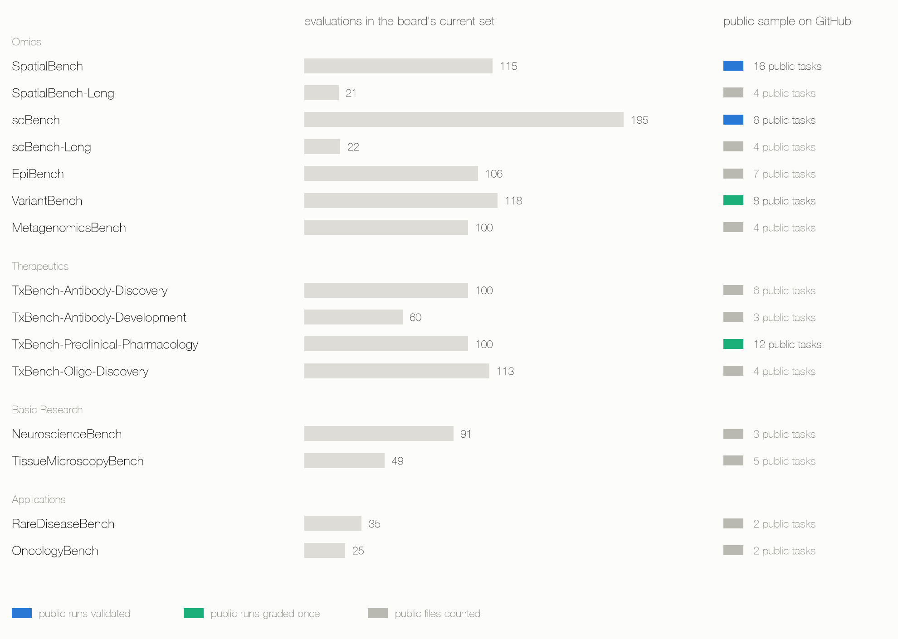

# The suite on benchmarks.bio, board by board

LatchBio's leaderboard site, [benchmarks.bio](https://benchmarks.bio), lists
21 boards. This page lines up each board outside biosecurity with its GitHub
repository and with what this tool can check for it.

Snapshot: the site's plain-text pages with its data date of 2026-11-17, and
the 15 repositories at the commits pinned in `scripts/fetch_upstream.sh`.
The site columns are copied from `results/suite/`, written by
`scripts/site_boards.py`. The repository columns are copied from
`results/family/inventory.csv`. The 6 biosecurity boards are left out on
purpose: their rows in the site's own table are counted, and their pages
are never read.

No result of any model is restated here. Nothing here was checked by a
person.

## 1. Where each board's public sample is, and what can be checked

| Board | Area | Horizon | Evaluations on the board | Repository | Public tasks | With a public grader | Runs with a published verdict | What this tool does |
|---|---|---|---:|---|---:|---:|---:|---|
| [SpatialBench](https://benchmarks.bio/spatial) | Omics | short | 115 | [spatialbench](https://github.com/latchbio/spatialbench) | 16 | 16 | 768 | validates the public runs |
| [SpatialBench-Long](https://benchmarks.bio/spatial-long) | Omics | long | 21 | [spatialbench-long](https://github.com/latchbio/spatialbench-long) | 4 | 0 | 16 | counts what is public |
| [scBench](https://benchmarks.bio/scbench) | Omics | short | 195 | [scbench](https://github.com/latchbio/scbench) | 6 | 6 | 273 | validates the public runs |
| [scBench-Long](https://benchmarks.bio/scbench-long) | Omics | long | 22 | [scbench-long](https://github.com/latchbio/scbench-long) | 4 | 0 | 0 | counts what is public |
| [EpiBench](https://benchmarks.bio/epibench) | Omics | short | 106 | [epibench](https://github.com/latchbio/epibench) | 7 | 0 | 0 | counts what is public |
| [VariantBench](https://benchmarks.bio/variant) | Omics | short | 118 | [variantbench](https://github.com/latchbio/variantbench) | 8 | 8 | 0 | grades the public runs once |
| [MetagenomicsBench](https://benchmarks.bio/metagenomics) | Omics | short | 100 | [metagenomicsbench](https://github.com/latchbio/metagenomicsbench) | 4 | 4 | 0 | counts what is public |
| [TxBench-Antibody-Discovery](https://benchmarks.bio/txbench-ab) | Therapeutics | short | 100 | [txbench-antibody-discovery](https://github.com/latchbio/txbench-antibody-discovery) | 6 | 0 | 0 | counts what is public |
| [TxBench-Antibody-Development](https://benchmarks.bio/txbench-abdev) | Therapeutics | short | 60 | [txBench-antibody-development](https://github.com/latchbio/txBench-antibody-development) | 3 | 0 | 0 | counts what is public |
| [TxBench-Preclinical-Pharmacology](https://benchmarks.bio/txbench) | Therapeutics | short | 100 | [txbench-pp](https://github.com/latchbio/txbench-pp) | 12 | 12 | 0 | grades the public runs once |
| [TxBench-Oligo-Discovery](https://benchmarks.bio/txbench-oligo) | Therapeutics | short | 113 | [txbench-oligo-discovery](https://github.com/latchbio/txbench-oligo-discovery) | 4 | 0 | 0 | counts what is public |
| [NeuroscienceBench](https://benchmarks.bio/neuroscience) | Basic Research | short | 91 | [neurobench](https://github.com/latchbio/neurobench) | 3 | 0 | 0 | counts what is public |
| [RareDiseaseBench](https://benchmarks.bio/raredisease) | Applications | long | 35 | [rarediseasebench](https://github.com/latchbio/rarediseasebench) | 2 | 2 | 0 | counts what is public |
| [TissueMicroscopyBench](https://benchmarks.bio/tissuemicroscopy) | Basic Research | short | 49 | [tissuemicroscopybench](https://github.com/latchbio/tissuemicroscopybench) | 5 | 0 | 0 | counts what is public |
| [OncologyBench](https://benchmarks.bio/oncology) | Applications | long | 25 | [oncologybench](https://github.com/latchbio/oncologybench) | 2 | 2 | 0 | counts what is public |

The plain-text page of TissueMicroscopyBench links no repository. Its row
uses the repository that the site's footer links.

In all: 15 boards outside biosecurity, with 1250 evaluations in their
current sets. Their repositories publish 86 tasks. This tool validates the
public runs of 2 boards, grades the public runs of 2 more once, and counts
what is public for the other 11.

The bars are the size of each board's current evaluation set. The colour is
on the public sample only: it says what this tool can do with the tasks and
runs on GitHub, not with the board.

The 2 kinds of number should not be mixed. A board's evaluation count is the
size of the set the site scores. A repository's public tasks are a sample,
and 4 repositories say theirs are not part of the benchmark
([FAMILY.md](FAMILY.md), section 1). The columns on the right say how much
an outside reader can check. They do not say how much of a board is covered.

What the 3 levels mean:

- **Validates the public runs.** The repository publishes graded runs with
  repeats. Verdicts are reproduced, repeats are compared and, for 3 tasks of
  each benchmark, the method behind each answer is traced
  ([FINDINGS.md](FINDINGS.md), [SPATIALBENCH.md](SPATIALBENCH.md)).
- **Grades the public runs once.** The repository publishes graders and
  transcripts and no verdicts. Answers are recovered from the transcripts
  and graded, with nothing to check the grading against
  ([FAMILY.md](FAMILY.md), section 3).
- **Counts what is public.** The repository publishes too little to grade.
  The files are counted ([FAMILY.md](FAMILY.md), section 1). The 16 published
  answers of spatialbench-long also serve in the test of the answer recovery
  ([FAMILY.md](FAMILY.md), section 3).

## 2. Which evaluation set a number refers to

4 of the 15 board pages say their current evaluation set is not the one in
the original study:

| Board | Evaluations in the original study | Evaluations in the current set |
|---|---:|---:|
| SpatialBench | 146 | 115 |
| SpatialBench-Long | 24 | 21 |
| scBench | 394 | 195 |
| scBench-Long | 21 | 22 |

The site calls these separately scoped releases. It asks that the current
set be cited for the board, and the original study for its historical
results.

Numbers in this repository come from the repositories and not from the
boards. The leaderboard statistics in [FINDINGS.md](FINDINGS.md) use the
195-task summary table in the scBench repository, which is the size of the
current board. Those in [SPATIALBENCH.md](SPATIALBENCH.md) use the 159-task
summary table in the SpatialBench repository, which is not the
115-evaluation set the board now scores.

## 3. What the site says about scoring

Only what its pages state, at the data date above.

- 21 leaderboards. The site counts 20 as capability benchmarks and scores 1
  apart, as safeguards.
- 13 of the 20 contribute to its overall score: 11 of the 15 boards above and
  2 biosecurity boards. A configuration may miss at most 2 of the 13.
- The overall score weights each board by a configured evaluation count. The
  site notes that this can differ from the size of the current set. It does
  for 2 boards, where the weight is the size in the original study:
  SpatialBench-Long (weight 24, set 21) and scBench-Long (weight 21, set 22).
- 4 of the 15 board pages say how a refusal is scored. On RareDiseaseBench and
  TissueMicroscopyBench a refusal is a failure, and on OncologyBench it stays
  in the denominator, so on all 3 it counts against the score. On
  NeuroscienceBench it is not graded and leaves the denominator. The other 11
  pages do not say.

## 4. What this page does not do

- It uses no result from the site, for any board or any task. Everything
  validated in this repository comes from the public samples on GitHub.
- It does not restate, rank or compare the results of any model.
- It does not cover the biosecurity boards: 6 boards with 552 evaluations.
- It is a snapshot. The boards move. The table regenerates with
  `python scripts/site_boards.py --out results/suite --figure`, and the
  checks in `tests/test_docs_numbers_suite.py` compare this page with the
  committed table, not with the live site.
